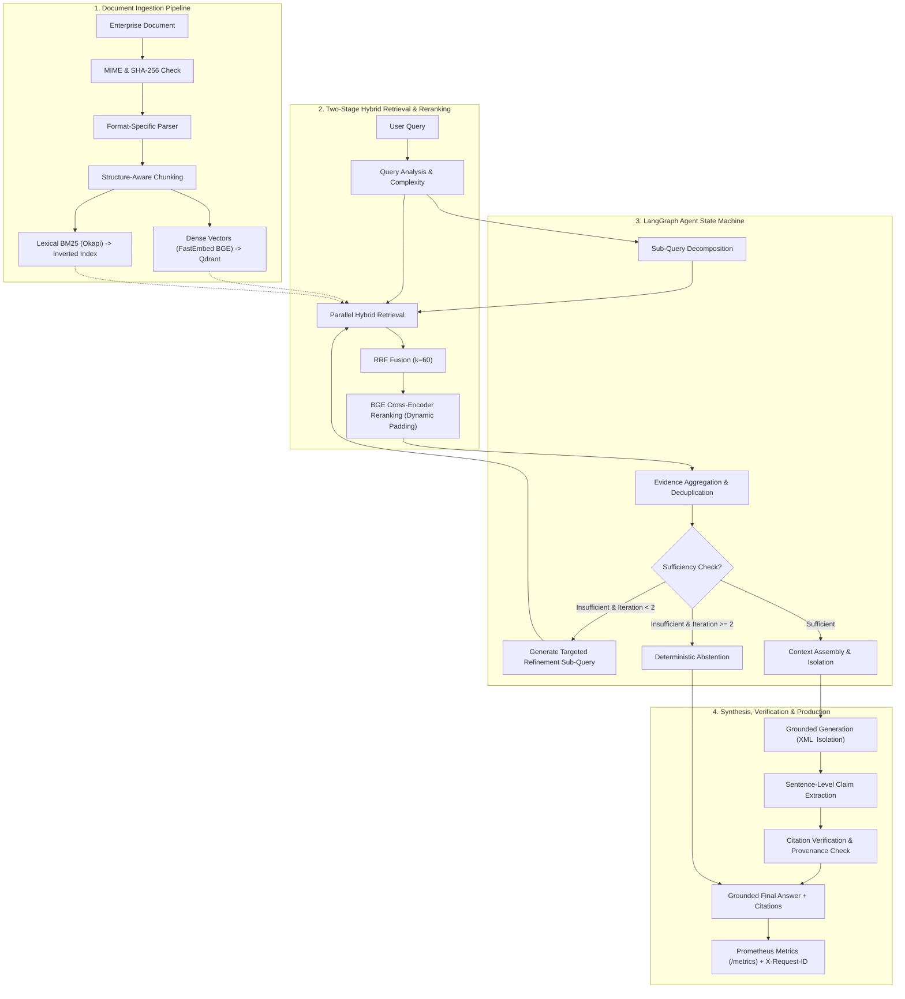

# End-to-End System Architecture: 2-Minute Executive Summary

**Project**: Enterprise AI Knowledge & Research Copilot  
**Author**: Machine Learning Systems Engineer  
**Purpose**: High-level technical overview for engineering leadership and technical interviews.

---

## 1. High-Level Pipeline Architecture

The Enterprise AI Knowledge & Research Copilot is a production-grade, zero-hallucination agentic RAG platform designed for complex enterprise document corpora (PDF, DOCX, TXT, MD, HTML).

---

## 2. The 10 Pipeline Stages (Interview Walkthrough)

### 1. Document Ingestion & Validation
- Validates file extensions (`pdf`, `docx`, `txt`, `md`, `html`) and size ($\le 50$ MB).
- Computes content SHA-256 to guarantee idempotency and prevent duplicate re-indexing.

### 2. Format-Specific Parsing & Structure-Aware Chunking
- Specialized parsers extract hierarchical headings (`# H1 > ## H2 > ### H3`), tables, and page numbers.
- Boundary-aware chunking preserves section lineage and token constraints ($300\text{--}500$ tokens), preventing semantic fragmentation across headings.

### 3. Dual Embedding & Inverted Indexing
- **Dense Vector**: Generates 384-dimensional embeddings via local ONNX FastEmbed (`BAAI/bge-small-en-v1.5`) stored in Qdrant with payload indexing on `document_id` and `page_number`.
- **Lexical Index**: Builds tokenized Okapi BM25 index on disk with stemming and stopword filtering.

### 4. Hybrid Retrieval via Reciprocal Rank Fusion (RRF)
- Runs dense similarity search and lexical BM25 in parallel.
- Fuses rank positions via parameter-free Reciprocal Rank Fusion ($k=60$), achieving **1.0000 Recall@3** across multi-format enterprise queries.

### 5. Neural Cross-Encoder Reranking (Optimized)
- Reranks top 10 candidates using `BAAI/bge-reranker-base`.
- Dynamic sequence padding delivers a **28.37x CPU inference speedup** (2,302 ms $\rightarrow$ 81 ms). Provides a **+5.3% relative lift in Recall@1** and raises NDCG@5 to 0.9160.

### 6. Evidence Aggregation & Context Assembly
- Deduplicates chunks across sub-queries by chunk ID while tracking full provenance (`Query -> SubQuery -> Chunk -> Document`).
- Packs chunks into token budget (max 2,000 tokens / 8,000 characters) preserving section headers and page metadata.

### 7. LangGraph Agent State Machine & Iterative Refinement
- Complex, multi-hop queries are classified and decomposed into 1–3 targeted sub-queries.
- Sufficiency evaluator audits evidence coverage against required aspects.
- Bounded iteration loop (`max_iterations = 2`) triggers targeted retrieval if evidence is missing, or falls back to clean abstention to eliminate infinite agent loops.

### 8. Grounded Answer Synthesis & Prompt Isolation
- Evidence context is encapsulated within explicit `<context>...</context>` XML tags with system prompt security notices defending against prompt injection.
- LLM synthesizes structured answers strictly constrained to supplied context.

### 9. Citation Verification & Hallucination Resistance
- Sentence-level claim extractor parses every factual assertion.
- Citation auditor cross-references claim citations against retrieved chunk IDs and textual support; achieved **100% citation validity** and **100% abstention accuracy** on negative queries.

### 10. Production Observability & Deployment
- Zero-dependency Prometheus exposition at `/metrics` (counters, histograms, gauges).
- Request correlation via `X-Request-ID` and `ContextVar` propagation.
- Multi-layer bounded LRU caching (71.88% embedding, 77.89% reranker hit rates) lowering warm response latency to **7.31 ms** (Single) and **25.33 ms** (Agent).
- Hardened Docker Compose deployment with PostgreSQL, Qdrant, persistent data volumes, and automated startup migrations.
