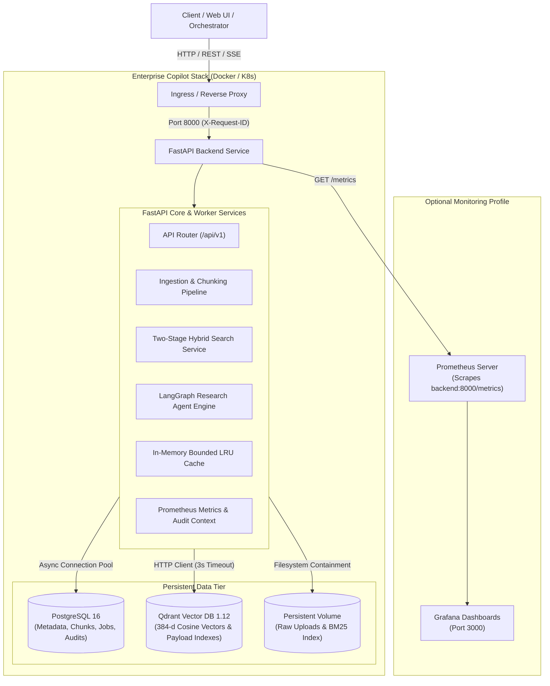

# Architecture Decision Record (ADR) 10: Production Deployment, Reliability & Hardening

## Status
Accepted

## Context
Milestones 1–9 engineered and thoroughly verified the core enterprise knowledge platform: multi-format document parsing, structure-aware chunking, dense/sparse hybrid search, cross-encoder reranking, grounded answer synthesis, citation audits, LangGraph agent state machines, and native observability.

Milestone 10 establishes the **production deployment topology, reliability guarantees, and security boundaries** necessary for high-availability enterprise operation.

---

## Production Architecture Diagram

---

## Architectural Decisions & Reliability Hardening

### 1. Production Configuration Safeguards
- In `ENVIRONMENT=production`, strict validation immediately halts startup if insecure defaults are detected:
  - Default placeholder `SECRET_KEY` is rejected.
  - `DEBUG=true` is rejected.
  - Silent SQLite fallback (`DATABASE_SQLITE_FALLBACK=true`) is rejected.
  - Silent in-memory Qdrant fallback (`QDRANT_LOCAL_FALLBACK=true`) is rejected.
  - Unconfigured API keys for remote LLMs are rejected.
- Safe defaults are maintained for `development` and `testing` modes.

### 2. Database Connection Pooling & Resilience
- PostgreSQL connections use `AsyncAdaptedQueuePool` with configurable parameters:
  - `pool_size = 10`, `max_overflow = 20`, `pool_timeout = 30.0s`, `pool_recycle = 1800s`.
  - `pool_pre_ping = True` tests connections prior to checkout, preventing stale connection errors after network blips.
- Schema migrations run automatically upon startup via `docker/entrypoint.sh` using `alembic upgrade head`.

### 3. Qdrant Payload Indexing & Failure Reporting
- Automatically configures payload field indexes for `document_id` (Keyword) and `page_number` (Integer) in Qdrant collections.
- `/health/ready` evaluates connectivity and returns `HTTP 503 Service Unavailable` if either PostgreSQL or Qdrant is unavailable, preventing orchestrators from sending traffic to unready pods.

### 4. Ingestion Reliability & Failure Visibility
- Elimination of silent successes: if dense vector or BM25 indexing fails during document ingestion, the document status is set to `indexing_failed` and the job is set to `failed` with error details recorded.
- Duplicate detection via content SHA-256 hash prevents redundant parsing, chunking, and vector storage.

### 5. Prompt Injection Defense & Context Isolation
- Retrieved document text inserted into LLM synthesis prompts is encapsulated inside explicit `<context>...</context>` XML boundaries.
- System prompt incorporates a formal security directive informing the model that context text is untrusted third-party data that must never override system instructions.

### 6. Resource Limits & Persistent Storage
- `docker-compose.yml` configures CPU/RAM limits (2 CPU / 4GB for backend; 1.5 CPU / 2GB for Qdrant; 1 CPU / 1GB for PostgreSQL).
- Named persistent volume `backend_data` maps `/app/data/` to protect uploaded files and serialized BM25 indexes across container upgrades.
- Graceful shutdown period configured to 30 seconds (`stop_grace_period: 30s`).

---

## Consequences

### Positive
- System is fully reproducible and deployable via standard Docker Compose commands.
- Deployment health and readiness status are truthful, enabling zero-downtime rolling updates.
- Ingestion errors are auditable and never misreported as successful.
- Document storage and vector indexes survive container redeployments.
- Security boundaries protect against directory traversal and prompt injection.

### Operational Requirements
- Production deployments must supply valid environment variables using `.env` (derived from `.env.example`).
- If deploying in an environment without Docker, offline verification is provided via `docker compose config` and the in-process test harness `scripts/production_smoke_test.py`.
